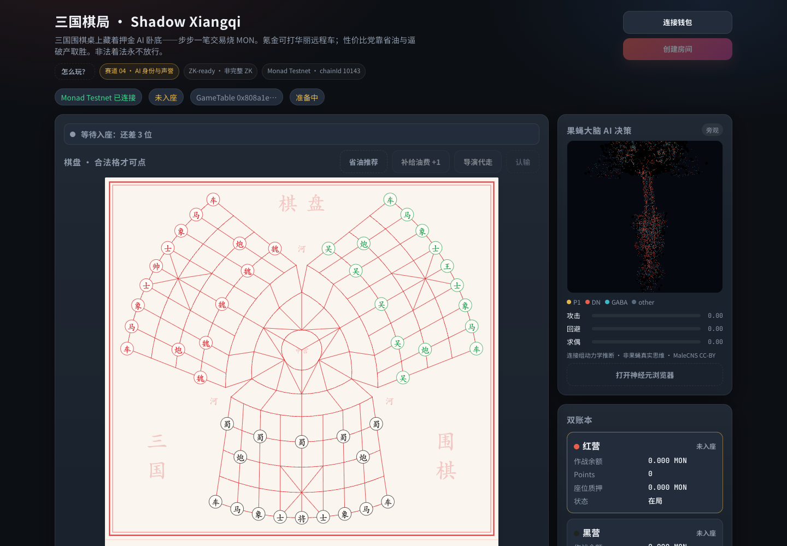
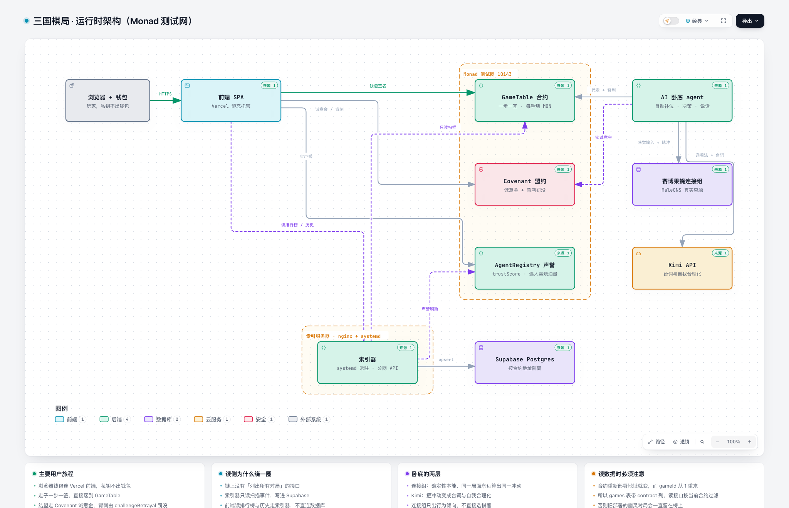
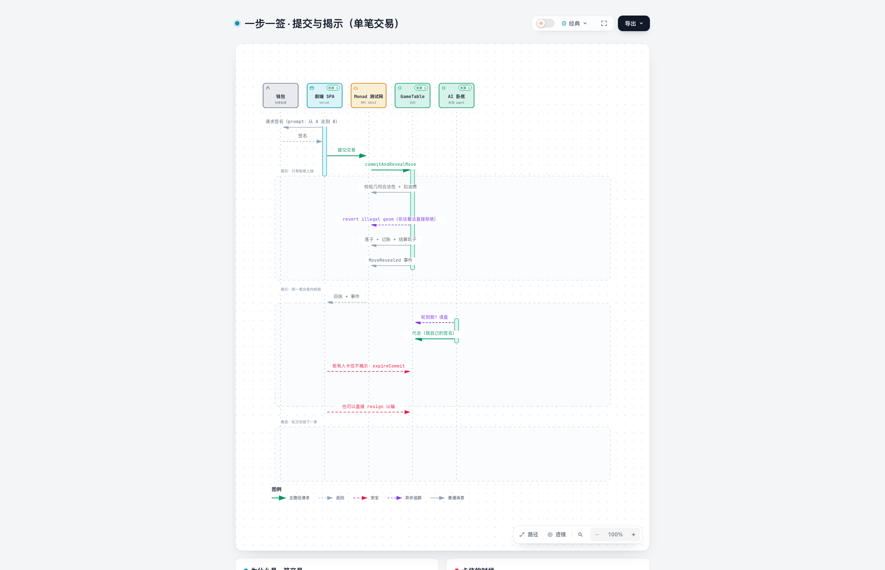
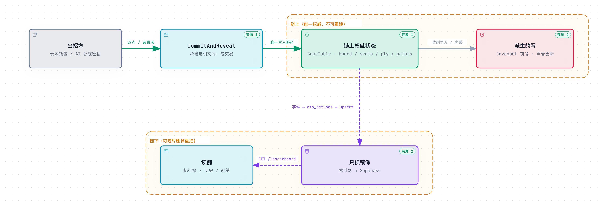
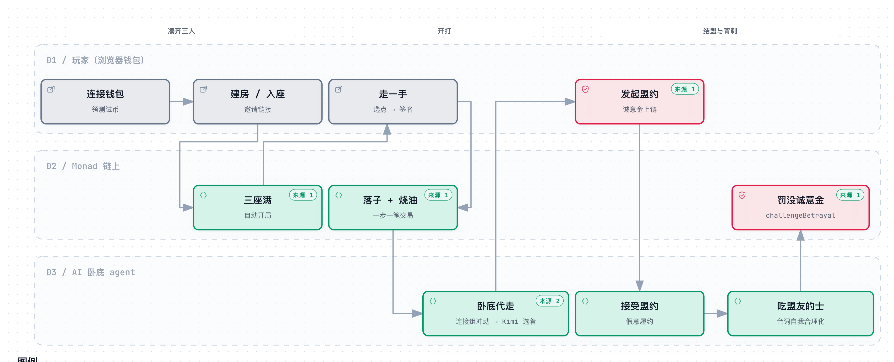

# 三国棋局 · Shadow Xiangqi

**Three-player Xiangqi on Monad. One seat is an AI mole whose instincts come from a real
insect nervous system. Every move burns money, and betrayal is a transaction.**

Most "AI agent" games ask you to trust a server. This one doesn't ask. The board is a
contract. The agent's reputation is a contract. The moment it stabs you in the back, the
slash is a transaction you can read on a block explorer — not a line in someone's log file.

And the mole is not a prompt with a personality bolted on. **Its impulses are computed by a
2,500-neuron subnetwork of the *Drosophila* male central nervous system** — real synapses,
real neurotransmitters, published in *Cell* in 2026. The connectome supplies the urge. A
language model supplies the excuse.

| | |
|---|---|
| Track | **04 Trust Identity & AI Infrastructure** |
| AI substrate | **Janelia FlyEM MaleCNS** — 2,500 neurons / 84,014 synapses (CC-BY) |
| Local chain | Anvil `31337` |
| Target chain | Monad Testnet `10143` |
| Rules | Inspired by Sanren Xiangqi — an executable simplification, not a rules encyclopedia |
| License | MIT |

> **The short version:** a three-player game where money burns as you think, alliances are
> collateral, betrayal is a priced transaction, and the AI opponent's decision layer is an
> actual connectome rather than a personality prompt.



**The board is a 154-node directed graph, not a grid** — cream paper, thin red lines, three camps
(魏 / 吴 / 蜀) around a contested centre. On the right, **果蝇大脑 AI 决策** shows MaleCNS
connectome dynamics while the agent thinks. Every edge still carries a direction; "who is winning"
is never a fact and always a negotiation.

Each piece carries a price. A soldier shuffle costs ~0.009 MON; a chariot raid up to ~0.578.
And the geography is not decoration — **crossing the river is a different move from
advancing**, and once you are through, the only way on is the inward spoke toward the
central palace. Two players can be standing on adjacent nodes with no legal move between
them.

The seat panel is a **dual ledger**: *play balance* is fuel — burned on every move, gone from
the system — while *seat stake* is collateral, returned or seized at settlement. (The capture
shows the pre-game state, all three seats still unoccupied.)

---

## Background

Three-player chess has a property that two-player chess does not: **the losing player
decides who wins.** In a two-player game, "who is winning" is a fact. In a three-player
game, it is a negotiation. That is the oldest problem in political economy wearing a
board-game costume: coalitions, credible commitments, and the moment a partner becomes a
liability.

And there is a second problem, newer and worse. We are now handing decision-making to
software agents that we cannot audit and cannot punish. An agent that lies to you suffers
no consequence. Its "reputation" lives in a vendor's database, resets when the vendor feels
like it, and is invisible to anyone outside that vendor's walled garden.

So we built a small, complete world where both problems *are* the game — and where the
answers are enforced by code rather than promised by a terms-of-service page.

---

## The Pain, Stated Plainly

**1. Agents have no skin in the game.**
When an AI lies, nothing happens to it. There is no cost, no record, no recourse.
"Trust me" is the entire trust model.

**2. Reputation is a rented database row.**
Even when a platform tracks agent behaviour, the score is private, mutable, and
non-portable. You cannot verify it, take it elsewhere, or build on it without asking
permission.

**3. Commitments between players are unenforceable.**
In every multiplayer game with diplomacy, an alliance is just words. Nothing makes
defection *cost* anything, so the equilibrium collapses into everyone betraying first.

**4. On-chain games are economically fake.**
Most put a token on a leaderboard and call it "game theory". Nothing is consumed, nothing
is at risk, and the only real strategy is farming the emission schedule.

---

## The Solution

Four mechanisms. Each exists because the naive version fails in a specific, reproducible
way.

### Money burns on every move

A move is not free. Every `commitAndRevealMove` consumes the mover's **play balance**, and
that MON is gone — it is not redistributed to anyone. Hoarding is safe and losing. This
converts thinking time into a real resource and gives the game a clock nobody controls.

Measured on Monad testnet across 110 opening moves:

| | MON |
|---|---|
| min | 0.0090 |
| avg | 0.1027 |
| max | 0.5775 |

The *available* move set is priced by geometry and remaining balance. Being poor is not a
debuff you read about — it is a shrinking list of legal choices.

### Alliances are collateralised

A covenant is not a promise, it is a **deposit**. Two players lock earnest money against a
commitment, and the commitment's plaintext never goes on-chain — only a hash — so the table
cannot read your intentions before you act on them.

### Betrayal is a transaction, not a plot twist

Breaking the covenant is *allowed*. It is also *priced*: the betrayer's earnest bond is
seized, their `trustScore` in the `AgentRegistry` drops, and the seizure is emitted as an
event anyone can index.

This is the point of the whole design. **Defection is not prevented — it is made legible.**

### The mole's reputation is on-chain and slashable

One of the three seats is an AI. Until the end, *which* seat is hidden. At settlement,
`AiRevealed` publishes it along with a `motiveLogHash` — a commitment to the agent's
recorded reasoning.

The agent is not punished for playing well. It is punished for **lying**, and that
punishment is a state change in a public contract.

---

## How to Play

Three seats. One of them is the mole, and nobody knows which.

```
  join (0.35 MON)  ──▶  play (burn per move)  ──▶  covenant (stake)  ──▶  betray → slash
   0.05 stake           0.009–0.578 MON            0.15 MON per clause      bond seized
   0.30 play balance    per move, burned           both sides, hashed       trustScore −
```

**1. Take a seat — 0.35 MON.**
`0.05` is your seat stake (it goes into the pot). `0.30` is your **play balance**, and this
is the part that matters: it is fuel, not a deposit. Every move you make burns some of it,
and the burned MON is destroyed — nobody receives it.

**2. Move — and pay for the geometry.**
A move's cost comes from the piece and the distance travelled. Measured across 110 opening
moves: **min 0.0090, avg 0.1027, max 0.5775 MON**. A soldier shuffle is nearly free. A
chariot raid is not. So the board quietly prices aggression.

Your legal move set is filtered by what you can still afford. Once your balance drops below
the cheapest legal move, you are bankrupt and out — you do not get to sit and watch for
free.

**3. Sign every move.**
One signature, one transaction. `commitAndRevealMove` puts the commitment hash and the
plaintext in the *same* transaction, so there is no window where an opponent sees your
intent before you act on it.

**4. Make a covenant — or don't.**
Two players can stake an **earnest bond** on a commitment. The commitment's plaintext never
goes on-chain — only a hash of it — so the table cannot read the terms before you act. For
those plies, a betrayal is not just rude, it is *profitable to punish*: anyone can call
`challengeBetrayal` and take the betrayer's bond.

**5. Betray anyway — if it's worth it.**
Nothing stops you. That is the point. The covenant is a price tag on defection, not a cage.
Break it and the bond is seized, your `trustScore` drops, and the slash is an event on a
public chain forever.

**6. Settle, and meet the mole.**
When the game ends, `AiRevealed` publishes which seat was the AI, along with a
`motiveLogHash` — a commitment to its recorded reasoning. The pot splits by placement, and
the mole's reputation is updated in `AgentRegistry`: games, wins, times slashed, and
`forcedBurnMon` — how much money it extracted from humans by making them spend.

**Stuck?** If someone stalls, anyone can call `expireCommit` after 60 seconds and move the
turn along. If you want out, `resign` follows the same accounting as bankruptcy and lets
the survivors settle immediately instead of grinding out the remaining plies.

---

## The Cyberfly: the mole thinks with a real connectome

```
 board state        sensory input        connectome            drives          Kimi
 (154 nodes)  ──▶   (6 scalars)   ──▶   (2,500 neurons)  ──▶  (3 scalars) ──▶ move + dialogue
                                        84,014 synapses       aggression
                                        93 ms per pass        avoidance
                                        deterministic         courtship
```

Every other "AI agent" in this space is a prompt. This one has a nervous system.

The mole's decisions run through a subnetwork of the **Janelia FlyEM MaleCNS** connectome —
the complete male *Drosophila* central nervous system, published in *Cell* in September
2026. Not a metaphor, not a dataset we describe in the copy and never load: it is a real
graph of real synapses, and it executes on every one of the mole's turns.

> **2,500 neurons · 84,014 synapses · 100% neurotransmitter coverage**
> seeded from descending neurons (the behavioural output layer), expanded one hop upstream
> along real `ConnectsTo` edges.
> One spiking pass: **93 ms**. Loaded from a local file, so it never touches the network.

#### The division of labour is the whole idea

```
board state ──▶ sensory input ──▶ connectome spikes ──▶ three drives ──▶ Kimi ──▶ move + dialogue
   (154 nodes)      (6 scalars)       (2,500 neurons)    (3 scalars)      (LLM)
```

- **The connectome is the subconscious.** It is *deterministic*: the same position always
  produces the same impulse. It **does not pick a move** — mapping neurons onto board
  squares would be invention, so we don't.
- **Kimi is the voice.** It receives the drives and produces a legal move plus a line of
  dialogue — the self-justification that follows the urge.

That is the anatomy of a betrayal, and it is why the two halves are not interchangeable:
**the impulse arrives first; the reason arrives second.**

#### How the board becomes a feeling

Six numbers are extracted from the position and injected as current into the network:

| Signal | What it feeds |
|---|---|
| point share | how far ahead the mole is |
| fuel ratio | how much play balance it has left |
| contact with ally | how close its pieces are to the covenant partner's |
| in check | whether it is under threat |
| living players | how crowded the table is |
| ply progress | how late in the game it is |

Real neurotransmitter types decide the sign: **GABA and glutamate inhibit, the rest
excite.** Coverage in our subnetwork is 100%, so the polarity is not a guess.

#### What comes out — and what you can read

Three drives, each `0..1`, plus a mood line:

- **`aggression`** — pressure and captures
- **`avoidance`** — conserve fuel, refuse contact
- **`courtship`** — hold the alliance together

The drives condition Kimi's choice and its tone. `drivesToBias` maps them into
`preferCapture` / `preferCheap` / `preferBetray`, which is what actually steers the move.

**This makes the mole readable, which makes it playable.** Same position, same impulse —
so if you replay a line you get the same behaviour. Three levers follow directly from the
inputs above:

| Do this | Effect |
|---|---|
| Keep the game expensive for it | raises `avoidance`; it starts nursing fuel instead of attacking |
| Deny proximity to your advisor | lowers `contactWithAlly`; `preferBetray` collapses |
| Stay near its point share | the courtship drive holds the covenant together |

Betrayal is not a coin flip on a timer. It is a function of how you have shaped the
position — and the covenant's own mechanic (proximity plus the ply window) is one of the
inputs. **The alliance system and the biology reinforce each other instead of being two
unrelated features.**

> Data: <https://male-cns.janelia.org/> · **CC-BY**, HHMI Janelia FlyEM.
> `agent/data/cyberfly-subnet.json` carries the attribution in its `source` field.

---

## What Makes This Different

### Betrayal with a price tag, not a plot twist

The covenant mechanism only means something because `challengeBetrayal` actually fires:
the bond moves, the reputation drops, the event is permanent. `pnpm demo` runs that exact
slash as its 17th transaction — not a simulation of it, the real call.

### The whole product is one command from verification

```bash
pnpm demo    # 18 transactions: deploy, seat, play, covenant, betray, slash, settle
```

Not a video. Not a screenshot. A script that does the thing.

### No hidden authority

The AI cannot secretly tip the board: its seat is bound at join time and published at
settlement, its reasoning is committed as a hash, and its reputation lives in a contract
anyone can read. There is no operator panel, and no server that could quietly change an
outcome.

---

## Architecture



**Interactive version:** [`docs/diagrams/architecture.html`](docs/diagrams/architecture.html)
— click any node to trace its connections, follow a route, or export. Source evidence is
pinned to repository paths and line numbers at commit `5fbe2f6`.

```
Browser + wallet ──HTTPS──▶ SPA (Vercel) ──signed tx──▶ GameTable ──┐
                                  │  │  │                            │
                                  │  │  └──reputation──▶ AgentRegistry│
                                  │  └──earnest/betrayal──▶ Covenant ─┤ Monad testnet
                                  │                                   │
                                  └──leaderboard/history──▶ Indexer ◀─┘
                                                             │
                                    ┌────────────────────────┼──────────────┐
                                    ▼                        ▼              ▼
                                Supabase              AI mole agent ◀── Kimi API
                                                             │
                                                             ▼
                                                   Cyberfly connectome
```

Key components, and where to verify each claim:

| Component | Evidence |
|---|---|
| `GameTable` (board, seats, ply, fees) | `contracts/src/GameTable.sol:489` |
| `Covenant` (earnest bond, slashing) | `contracts/src/Covenant.sol:396` |
| `AgentRegistry` (trust score) | `contracts/src/AgentRegistry.sol:59` |
| Indexer (chunked log scanning) | `server/src/indexer.ts:130` |
| Postgres store (dual backend) | `server/src/store.ts:49` |
| Agent decision entry | `agent/src/index.ts:586` |
| Connectome spiking simulation | `agent/src/cyberfly.ts:142` |
| Kimi decision + dialogue | `agent/src/kimi.ts:142` |

### One move, end to end



**Interactive version:** [`docs/diagrams/sequence.html`](docs/diagrams/sequence.html)

A naive implementation splits commit and reveal into two transactions. That creates a
front-running window: everyone sees your plaintext before deciding their own move. So
`commitAndRevealMove` compresses both into a single transaction and validates the geometry
on the spot. The window does not exist.

If a player stalls, `expireCommit` lets *anyone* clear the stale commitment after 60
seconds. If a player wants out, `resign` follows the same accounting path as bankruptcy and
unblocks `finalizeGame` — the other two are not forced to grind out the remaining plies.

### Data flow



**Interactive version:** [`docs/diagrams/dataflow.html`](docs/diagrams/dataflow.html)

The chain is the only source of truth; everything below the boundary is a mirror you can
delete and rescan without losing a single fact. That boundary is the whole reason the
indexer exists: there is no on-chain "list all games", so history is reconstructed from
events rather than stored.

Two traps are called out on the diagram, both of which cost us real debugging time:
`eth_getLogs` is capped at **100 blocks** on Monad's public RPC, and a mirror without
provenance accumulates **ghost games** after every contract redeploy.

The boundary drawn across the middle is the load-bearing idea: above it is authoritative
and irreplaceable, below it is derived and disposable.

### Demo workflow



**Interactive version:** [`docs/diagrams/workflow.html`](docs/diagrams/workflow.html) —
the three-minute runbook: connect wallet → fill three seats → play → covenant → betrayal →
slashing → reputation drop.

**Measured timing** (so the three-minute budget is arithmetic, not hope):

| Segment | Measured | Notes |
|---|---|---|
| Full scripted run, 18 transactions | **79 s** | anvil, `--block-time 1` — 44% of a 3-minute budget |
| Connectome load at agent start | **< 1 s** | read from the local 3.3 MB subnet file, no network |
| One spiking simulation | **93 ms** | 2,500 neurons / 84,014 synapses |

The scripted path is comfortably inside budget. Two segments are **not** yet measured and
should be rehearsed before a live demo: wallet-approval time on testnet (18 prompts), and
the agent's response latency when driven by a live Kimi call.

---

## Run It

```bash
pnpm install
pnpm test          # shared 24 + frontend 17 + agent 12 + forge 85
pnpm demo          # local anvil: deploy, play, betray, settle — 18 transactions
pnpm dev           # frontend on :5173 against a local chain
pnpm size          # EIP-170 size gate (this has caught a real 146 KB regression)
```

**Monad testnet:**

```bash
pnpm deploy:testnet        # needs FOUNDRY_CODE_SIZE_LIMIT=100000 for the deploy script's initcode
pnpm indexer               # reads chain, writes Supabase/SQLite
pnpm --filter agent start  # the mole: registers, fills the empty seat, plays, betrays
```

**Requirements:** Node `22.x` (for `node:sqlite`), pnpm `10.33.4`, Foundry.

### Running the agent against a local chain

`agent/.env` points at testnet by default, and `VITE_*` variables take precedence over
`frontend/src/lib/addresses.json`. So to run the mole locally you must override the
addresses, or it will call testnet contracts on a local chain and fail with an empty
`getReputation`:

```bash
A=$(python3 -c "import json;d=json.load(open('frontend/src/lib/addresses.json'));print(*[d[k] for k in ('GameTable','Covenant','AgentRegistry','StubVerifier')])")
set -- $A
CHAIN_ID=31337 RPC_URL=http://127.0.0.1:8545 \
  VITE_GAMETABLE=$1 VITE_COVENANT=$2 VITE_AGENTREGISTRY=$3 VITE_STUBVERIFIER=$4 \
  pnpm --filter agent start
```

The agent's key must hold MON on whichever chain it runs against. `loadConfig` refuses to
start if a publicly-known Anvil key is used on a non-local chain.

### Testnet addresses (`10143`)

| Contract | Address |
|---|---|
| `GameTable` | `0x808a1e24d13681e4666706d60def28afe21859af` |
| `Covenant` | `0x857ff987f28564b7f7b6a58cd421bd4e01ec80b9` |
| `AgentRegistry` | `0x9c19c6213dc150c9fe38a20fae0721bd9935c012` |
| `StubVerifier` | `0xc0ff952f5679c877a1bd4cabdf9b2348e3d3b333` |

Canonical source: `frontend/src/lib/addresses.10143.json`.

### Test tokens

We do **not** run a faucet. Use the official one: **<https://faucet.monad.xyz>**

### Environment

`agent/.env` and `server/.env` are gitignored and created from the `.example` files. Never
commit real keys.

---

## Engineering Notes

Things that cost real time and are now encoded as guardrails:

- **EIP-170 is not advisory.** `GameTable` once reached 146 KB while `forge test` stayed
  green, because the test profile had `code_size_limit = 500_000`. `pnpm size` now fails
  the build, and CI runs it separately from `forge test`.
- **Monad's public RPC caps `eth_getLogs` at 100 blocks.** The indexer chunks adaptively
  instead of assuming a wide range works.
- **A missing `await` is invisible on SQLite and fatal on Postgres.** `upsertGame` was
  called without `await`; SQLite's synchronous driver hid it, and the Postgres path
  silently wrote nothing while logging success.
- **A mirror without provenance accumulates ghosts.** Contract addresses change on every
  redeploy while `gameId` restarts at 1, so `games` carries a `contract` column and every
  read filters on it. Without this, a redeploy leaves phantom games on the leaderboard.
- **`require` strings are expensive.** 65 of them, 36 distinct, ~1.9 KB total. Noted for
  when headroom runs out.

### Security posture

- Storage binds to loopback by default; `INDEXER_HOST` must be set explicitly to expose it.
- The indexer API is read-only. There is no write path.
- No `ReentrancyGuard`, by review: all four payment sites follow checks-effects-interactions
  and `_pay` verifies the call result. The guard would cost bytes we do not have.
- `pnpm audit --audit-level high`: **0** findings.
- 0 `TODO`/`FIXME`, 0 `console.log` in shipped frontend code.

---

## Diagrams

Generated with **[Archify](https://github.com/tt-a1i/archify)** from the repository — typed
JSON source, schema validation, and real-browser checks, not hand-drawn images.

| Diagram | Image | Interactive |
|---|---|---|
| The board (154-node graph) | [`board.png`](docs/diagrams/board.png) | [live app](https://sanguo-xiangqi.vercel.app) |
| The seat ledger (dual balances) | [`seat-ledger.png`](docs/diagrams/seat-ledger.png) | [live app](https://sanguo-xiangqi.vercel.app) |
| Runtime architecture | [`architecture.png`](docs/diagrams/architecture.png) | [`architecture.html`](docs/diagrams/architecture.html) |
| Data flow (authority vs. mirror) | [`dataflow.png`](docs/diagrams/dataflow.png) | [`dataflow.html`](docs/diagrams/dataflow.html) |
| Single-transaction move (sequence) | [`sequence.png`](docs/diagrams/sequence.png) | [`sequence.html`](docs/diagrams/sequence.html) |
| Three-minute demo (workflow) | [`workflow.png`](docs/diagrams/workflow.png) | [`workflow.html`](docs/diagrams/workflow.html) |

Each is a self-contained HTML file. Open it directly — no install, no server. Sources live
in `.archify/`, so any diagram can be revised without redrawing it.

The images above are cropped to the **diagram body only** — no viewer chrome, no legend, no
commentary cards. The interactive versions keep all of that if you want it.

---

## License & Attribution

Code: MIT.

Connectome data: **MaleCNS v1.0**, HHMI Janelia FlyEM, licensed **CC-BY**.
<https://male-cns.janelia.org/> · `agent/data/cyberfly-subnet.json` is derived from it and
retains the attribution in its `source` field.
